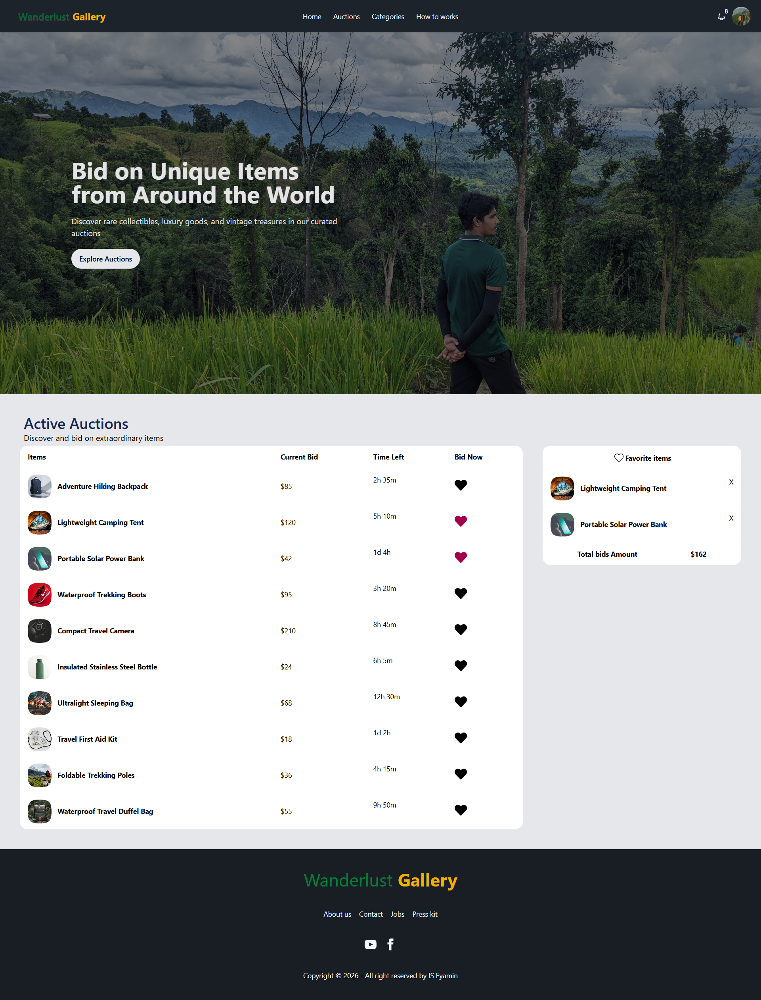

# 🌍 Wanderlust Gallery

An auction-style web app where users can browse unique items from around the world, add their favorites with a ❤️ click, and see the total bid amount update instantly. Your favorites are saved in the browser, so they're still there after a refresh. 💾

🔗 **Live Demo:** _https://wanderlust-gear.surge.sh/_

---

## ✨ Features

- 🏺 **Active Auctions table**: browse items with image, title, current bid and time left
- ❤️ **Add to favorites**: click the heart to add an item to your favorites list
- 🔒 **Duplicate protection**: an item already in favorites can't be added twice
- ❌ **Remove favorites**: remove an item and the total updates automatically
- 💰 **Live total**: the total bids amount recalculates on every change
- 💾 **Persistent favorites**: saved with `localStorage`, restored on page reload
- 📭 **Empty state**: a friendly message when there are no favorites yet
- ⏳ **Loading state**: Suspense fallback while the gear data loads
- 📱 **Responsive design**: works on mobile, tablet and desktop
- 🎨 **Hero banner, navbar and footer** with social links

---

## 🛠️ Tech Stack

| Technology | Purpose |
|------------|---------|
| ⚛️ React | UI library (`useState`, `useEffect`, `Suspense`, `use`) |
| ⚡ Vite | Fast build tool and dev server |
| 🎨 Tailwind CSS | Utility-first styling |
| 🌼 DaisyUI | Ready-made UI components |
| 🎯 React Icons | Heart and other icons |
| 💾 localStorage | Saving favorites in the browser |
| 📄 JSON | Local data source (`gears.json`) |

---

## 📸 Screenshot



---

## 📁 Project Structure

```
src/
├── components/
│   ├── navbar/      # 🧭 Top navigation bar
│   ├── hero/        # 🖼️ Hero banner
│   ├── items/       # 📋 Auction items table
│   ├── item/        # 🧾 Single auction row
│   ├── favorite/    # ⭐ Favorites panel and total
│   ├── fitem/       # 💖 Single favorite row
│   ├── noitem/      # 📭 Empty favorites message
│   └── footer/      # 🦶 Footer with links
├── utility/
│   └── utility.js   # 💾 localStorage helpers (get, add, remove)
├── App.jsx          # 🧠 Main state and layout
└── main.jsx         # 🚀 Entry point
public/
└── gears.json       # 📦 Auction items data
```

---

## 🚀 Getting Started

### 📋 Prerequisites
- 🟢 Node.js (v18 or later)
- 📦 npm

### ⚙️ Installation

```bash
# 1️⃣ Clone the repository
git clone https://github.com/iseyamin/travel-giars.git

# 2️⃣ Go to the project folder
cd travel-giars

# 3️⃣ Install dependencies
npm install

# 4️⃣ Start the development server
npm run dev
```

Then open the local URL shown in your terminal 🌐

### 🏗️ Build for production

```bash
npm run build
```

---

---

## 🧠 How It Works

1. 📥 Item data is fetched **once** from `gears.json` and shared with the table.
2. ❤️ Clicking the heart sends the item up to `App`, which stores it in the `selected` state.
3. 💵 The bid price is added to the running `count` total.
4. 💾 The item's `id` is saved in `localStorage` under the key `bid`.
5. 🔄 On page load, saved ids are read back and matched with the item data to restore favorites and the total.
6. ❌ Clicking **X** in the favorites panel removes the item, subtracts its price and deletes its id from `localStorage`.

### 💡 Key Concept: Single Source of Truth

The `selected` state in `App` is the only place that tracks favorites. Each row's heart button is **derived** from it:

```jsx
isSelected={selected.some(s => s.id === data.id)}
```

- ✅ Item in favorites → heart is pink and the button is disabled
- 🔓 Item removed → `selected` changes, React re-renders, and the heart is enabled again

There's no separate "disabled" state per row, so the UI can't get out of sync.

---

## 🔮 Future Improvements

- 🔍 Search and filter items
- 🏷️ Category pages
- 🕒 Real countdown timers
- 🔐 User login and real bidding

---

## 👨‍💻 Author

**IS Eyamin**

- 🎥 YouTube: [@ISwanderlust](https://www.youtube.com/@ISwanderlust)
- 📘 Facebook: [iswanderlust](https://web.facebook.com/iswanderlust)
- 🐙 GitHub: [@iseyamin](https://github.com/iseyamin)

---

⭐ If you like this project, give it a star on GitHub!
